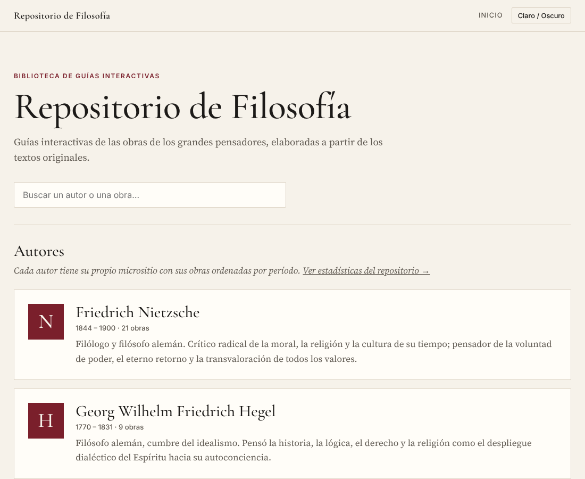
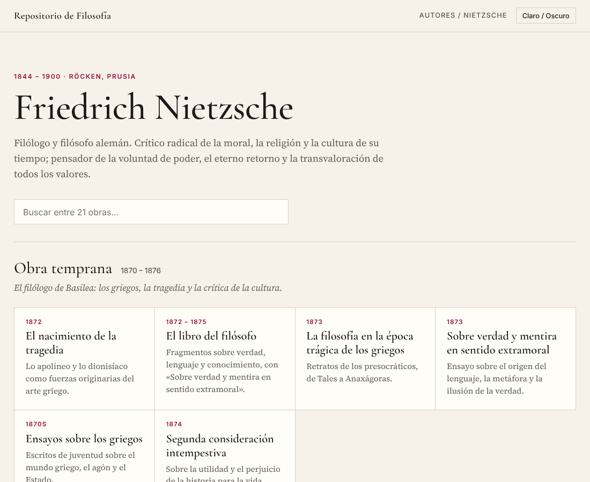
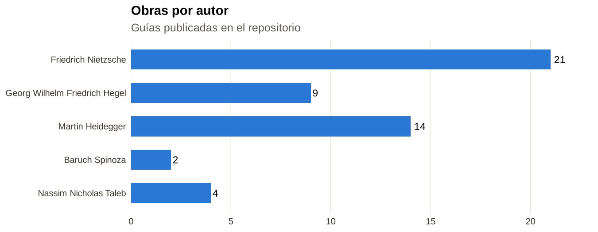
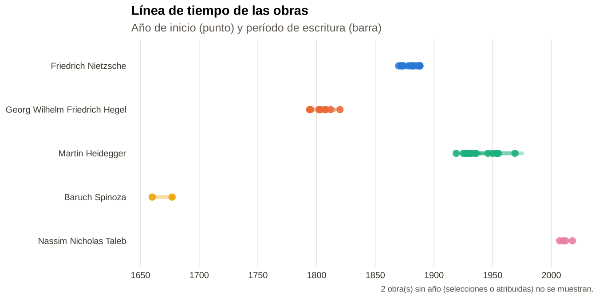
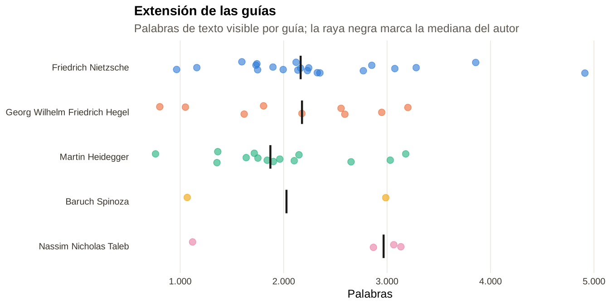
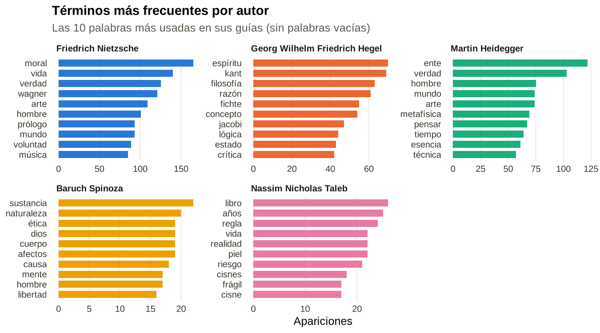
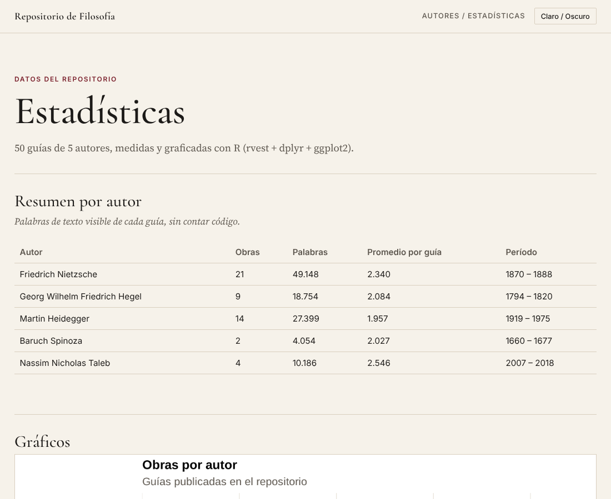

# Qué vamos a construir

El **Repositorio de Filosofía** es un sitio web estático: un conjunto de archivos HTML que se pueden abrir con cualquier navegador y publicar gratis en GitHub Pages, sin servidor ni base de datos. Hoy lo genera un script de Python (`construir.py`). En esta guía vas a aprender a generarlo **desde RStudio, con R**, y además a sacarle datos para hacer gráficos sobre los autores.

Al terminar vas a tener:

- **El mismo sitio que hoy**, generado por R. Lo verificamos: con la opción `con_estadisticas = FALSE`, los 58 archivos que produce R son idénticos, byte por byte, a los que produce Python.
- **Una página nueva de estadísticas** (`sitio/estadisticas/`) con una tabla y cuatro gráficos hechos con ggplot2.
- **Tablas de datos** (`datos/obras.csv`, `datos/terminos.csv`) para seguir analizando por tu cuenta.
- **Un flujo de trabajo ordenado**: un proyecto de RStudio, funciones en `R/` y scripts numerados en `scripts/` que se corren en orden.



## Cómo leer esta guía

Cada capítulo explica *por qué* se hace algo y después *cómo* se hace en R. El código completo está en el repositorio, listo para correr; acá vas a ver las partes importantes comentadas. Si algo no te sale, el capítulo 11 junta los errores más comunes.

No hace falta saber mucho R. Alcanza con saber que:

- `x <- 5` guarda el valor 5 en la variable `x`.
- `funcion(argumento)` ejecuta una función.
- `|>` (el "pipe") pasa el resultado de la izquierda como primer argumento de la función de la derecha. `datos |> filter(x > 1)` es lo mismo que `filter(datos, x > 1)`. Se lee "y después".
- `#` empieza un comentario: R lo ignora.

# Requisitos e instalación

## Programas

1. **R** (versión 4.1 o más nueva, por el pipe `|>`): <https://cran.r-project.org>. Instalalo primero.
2. **RStudio Desktop**: <https://posit.co/download/rstudio-desktop/>. Es el editor; usa el R que instalaste.
3. **Git** (para bajar y subir el repositorio): <https://git-scm.com>. En RStudio después aparece la pestaña *Git*.
4. *Opcional*: **Quarto** (viene incluido en RStudio reciente) para renderizar esta misma guía.

## Bajar el repositorio como proyecto de RStudio

En RStudio: *File → New Project → Version Control → Git*, y pegá la URL del repositorio (`https://github.com/martinparatz/repositorio-filosofia`). RStudio lo clona y lo abre. Desde entonces, abrí siempre el archivo **`repositorio-filosofia.Rproj`**: así el *directorio de trabajo* es la raíz del repositorio y todas las rutas relativas (`"catalogo.json"`, `"fuentes/..."`) funcionan sin tocar nada.

## Paquetes

Abrí `scripts/00_instalar_paquetes.R` y corrélo (botón **Source**). Instala solo lo que falte:

```{r}
paquetes <- c(
  "jsonlite",  # leer catalogo.json
  "glue",      # plantillas de texto con {llaves}
  "stringr",   # expresiones regulares y manejo de texto
  "rvest",     # leer y recorrer HTML (web scraping)
  "xml2",      # base de rvest: modificar el árbol HTML
  "dplyr",     # transformar tablas (filter, mutate, summarise...)
  "tidyr",     # ordenar tablas (unnest, pivot...)
  "purrr",     # aplicar una función a cada elemento (map)
  "forcats",   # ordenar factores (categorías) en los gráficos
  "ggplot2",   # gráficos
  "scales",    # formato de números en los ejes
  "readr"      # guardar y leer CSV
)
faltan <- setdiff(paquetes, rownames(installed.packages()))
if (length(faltan) > 0) install.packages(faltan)
```

Varios de estos paquetes forman parte del **tidyverse**; podés instalar todo junto con `install.packages("tidyverse")`, pero no hace falta.

**Opcionales**: `plotly` (gráficos interactivos), `servr` (servidor local para previsualizar), `renv` (congelar versiones de paquetes) y `quarto` (renderizar informes desde R).

## Reproducibilidad con renv (recomendado)

`renv` guarda en un archivo (`renv.lock`) la versión exacta de cada paquete. Si dentro de un año cambiás de computadora, `renv::restore()` instala exactamente las mismas versiones.

```{r}
install.packages("renv")
renv::init()      # una sola vez: crea renv.lock y la carpeta renv/
renv::snapshot()  # cada vez que agregás o actualizás un paquete
renv::restore()   # en otra computadora: reinstala todo igual
```

# Estructura del proyecto

```
repositorio-filosofia/
├── repositorio-filosofia.Rproj ← abrir SIEMPRE esto
├── catalogo.json      ← DATOS: autores, períodos, obras
├── fuentes/           ← DATOS: guías HTML de NotebookLM
│   ├── nietzsche/<obra>.html
│   └── hegel/ …
├── plantillas/        ← DISEÑO: CSS, JS y fuentes web
├── R/                 ← FUNCIONES (se cargan, no se corren)
│   ├── utilidades.R      leer/escribir, escapar HTML
│   ├── plantillas.R      moldes de HTML con glue
│   ├── datos.R           catálogo → tabla, rvest
│   ├── visualizacion.R   gráficos y estadísticas
│   └── construir_sitio.R la función principal
├── scripts/           ← PASOS (se corren en orden)
│   ├── 00_instalar_paquetes.R
│   ├── 01_explorar_catalogo.R
│   ├── 02_procesar_guias.R
│   ├── 03_visualizar.R
│   ├── 04_construir_sitio.R
│   ├── 05_verificar.R
│   └── 06_previsualizar.R
├── construir.R        ← atajo: Rscript construir.R
├── construir.py       ← versión original en Python
├── guia-r/            ← esta guía
├── datos/, salidas/   ← intermedios (no van a Git)
└── sitio/             ← RESULTADO publicado (no va a Git)
```

La idea central es **separar** tres cosas que cambian por motivos distintos:

| Qué | Dónde | Cuándo lo tocás |
|---|---|---|
| Datos | `catalogo.json`, `fuentes/` | Cuando agregás un autor u obra |
| Diseño | `plantillas/` | Cuando querés cambiar el aspecto |
| Lógica | `R/` | Cuando querés que el sitio haga algo nuevo |

Y otra distinción importante para quien empieza: **las funciones van en `R/`** (definen herramientas, no hacen nada al cargarlas) y **los scripts van en `scripts/`** (usan esas herramientas, paso a paso). Cada script empieza cargando las funciones:

```{r}
for (f in sort(list.files("R", pattern = "\\.R$", full.names = TRUE))) {
  suppressPackageStartupMessages(source(f, encoding = "UTF-8"))
}
```

`datos/`, `salidas/` y `sitio/` están en `.gitignore`: se pueden regenerar en segundos, así que no tiene sentido versionarlos. Lo que publica el sitio es GitHub Actions, que lo construye de cero (capítulo 10).

# Arquitectura del sitio

## Tres niveles de páginas

```
sitio/
├── index.html              ← PORTADA: autores, obras, buscador
├── estilo.css              ← un CSS para todas las páginas
├── estadisticas/index.html ← (nuevo, solo R) tabla y gráficos
└── nietzsche/
    ├── index.html          ← MICROSITIO: obras por período
    └── aurora.html         ← GUÍA original + barra para volver
```

Las direcciones quedan simples: `/nietzsche/`, `/nietzsche/aurora.html`, `/hegel/ciencia-de-la-logica.html`.



## El flujo de datos

```
catalogo.json ──┐
                ├──► construir_sitio() ──► sitio/ ──► GitHub Pages
fuentes/*.html ─┤          ▲
plantillas/ ────┘          │
                   R/plantillas.R (moldes)
                   R/visualizacion.R (estadísticas)
```

`construir_sitio()` hace siempre lo mismo, en este orden:

1. Lee `catalogo.json`.
2. Borra `sitio/` y lo vuelve a crear vacío (así nunca quedan archivos viejos).
3. Copia `estilo.css` y crea `.nojekyll` (le dice a GitHub Pages que no procese los archivos).
4. Para cada autor: crea su carpeta; para cada obra, copia la guía e **inserta la barra «← Autor / Inicio»**; arma el `index.html` del autor.
5. (Opcional) Genera la página de estadísticas.
6. Arma la portada general con todos los autores y todas las obras.

## ¿Por qué un sitio estático?

Porque las guías ya son HTML completos e interactivos. No hace falta un servidor que calcule nada cuando alguien visita el sitio: todo se calcula **una vez**, al construir. Eso lo hace gratis de publicar, rapidísimo y muy difícil de romper.

# Diseño: CSS y plantillas HTML

## El CSS

`plantillas/estilo.css` define el aspecto con **variables CSS** (las que empiezan con `--`). Cambiando una variable cambia todo el sitio:

```css
:root{
  --bg:#f6f2ea; --surface:#fffdf8; --ink:#1c1a18; --muted:#5e5850; --rule:#d9cfbf;
  --accent:#7a1f2b; --accent-soft:#f1e2df;
  --serif:'Cormorant Garamond',Georgia,serif; --text:'Source Serif 4',Georgia,serif; --sans:'Inter',system-ui,sans-serif;
}
```

- **Tema oscuro**: el mismo bloque se redefine dentro de `@media (prefers-color-scheme:dark)` y de `:root[data-theme="dark"]`. El botón *Claro / Oscuro* (`plantillas/tema.js`) cambia `data-theme` y lo recuerda en el navegador.
- **Color por autor**: cada autor tiene un `acento` en el catálogo. La función `aplicar_acento()` lo inyecta en el `<head>` de su micrositio.
- **Grillas**: `.grid` usa `grid-template-columns: repeat(auto-fill, minmax(250px, 1fr))`, que acomoda tantas columnas como entren; en el celular queda una sola.
- **Buscador**: `plantillas/buscar.js` filtra las tarjetas mientras escribís. Busca dentro del atributo `data-buscar` de cada tarjeta, sin distinguir mayúsculas ni tildes.

En la versión Python, el CSS y el JavaScript estaban escritos *dentro* de `construir.py`. En R los sacamos a archivos propios en `plantillas/`: así se pueden editar con resaltado de sintaxis en RStudio y no se mezclan con la lógica.

## Plantillas con glue

Una plantilla es un texto con huecos. Con el paquete **glue**, todo lo que está entre `{llaves}` se reemplaza por el valor de esa expresión de R:

```{r}
library(glue)
autor <- "Spinoza"
n <- 2
glue("{autor} tiene {n} obras")   # Spinoza tiene 2 obras
```

Así está hecha la página base (`R/plantillas.R`). Fijate el argumento `.trim = FALSE`: le pide a glue que no toque los saltos de línea, para que el resultado sea exactamente el esperado.

```{r}
pagina <- function(titulo, descripcion, raiz, miga, cuerpo, pie) {
  fuentes_web <- leer_plantilla("fuentes-web.html")
  js_tema     <- leer_plantilla("tema.js")
  js_buscar   <- leer_plantilla("buscar.js")
  as.character(glue('<!doctype html>
<html lang="es">
<head>
<meta charset="utf-8">
<meta name="viewport" content="width=device-width, initial-scale=1">
<title>{e(titulo)}</title>
<meta name="description" content="{e(descripcion)}">
{fuentes_web}
<link rel="stylesheet" href="{raiz}estilo.css">
</head>
<body>
  … encabezado, <main>{cuerpo}</main>, pie y scripts …
</body>
</html>
', .trim = FALSE))
}
```

El argumento `raiz` resuelve un problema típico de los sitios estáticos: desde la portada el CSS está en `estilo.css`, pero desde `nietzsche/index.html` está en `../estilo.css`. Pasando `raiz = ""` o `raiz = "../"`, la misma plantilla sirve para los dos niveles.

## Escapar el texto: la función e()

Si un título tuviera el carácter `<` o `&`, el navegador lo confundiría con código HTML. Por eso **todo texto que viene del catálogo pasa por `e()`** antes de entrar en una plantilla:

```{r}
e <- function(x) {
  if (is.null(x)) x <- ""
  x <- as.character(x)
  x <- gsub("&", "&amp;", x, fixed = TRUE)   # ¡el & siempre primero!
  x <- gsub("<", "&lt;", x, fixed = TRUE)
  x <- gsub(">", "&gt;", x, fixed = TRUE)
  x <- gsub("\"", "&quot;", x, fixed = TRUE)
  x <- gsub("'", "&#x27;", x, fixed = TRUE)
  x
}
e("Ser & tiempo <1927>")   # "Ser &amp; tiempo &lt;1927&gt;"
```

El paquete **htmltools** tiene `htmlEscape()`, que hace casi lo mismo. Escribimos la nuestra para que el resultado sea idéntico al de Python (`html.escape`), que también escapa la comilla simple.

## Componentes: tarjetas y secciones

Cada pieza que se repite es una función pequeña. Por ejemplo, la tarjeta de una obra:

```{r}
tarjeta_obra <- function(o, href, autor = NULL) {
  extra  <- if (is.null(autor)) "" else paste0(" · ", autor)
  buscar <- paste0(o$titulo, " ", o$anio, " ", o$descripcion, " ", if (is.null(autor)) "" else autor)
  glue('<a class="card" href="{href}" data-buscar="{e(buscar)}">',
       '<span class="anio">{e(o$anio)}{e(extra)}</span>',
       '<h3>{e(o$titulo)}</h3><p>{e(o$descripcion)}</p></a>')
}
```

Probala en la consola:

```{r}
tarjeta_obra(list(titulo = "Ética", anio = "1677", descripcion = "Demostrada según el orden geométrico."),
             href = "etica-demostrada.html")
```

Las demás siguen el mismo patrón: `seccion_periodo()`, `tarjeta_autor()`, `barra_volver()` (los dos botones flotantes que se insertan en cada guía) y `aplicar_acento()`.

# Recolección de datos

El sitio tiene **dos fuentes de datos**, y ninguna se descarga de internet al construir.

## 1. Las guías HTML (`fuentes/`)

Cada guía se genera con **NotebookLM** a partir de la obra original y se exporta como un único archivo HTML, con su propio CSS y JavaScript adentro. Se guardan en `fuentes/<autor>/<obra>.html`, con nombres en minúscula, sin tildes y con guiones (`asi-hablo-zaratustra.html`). Ese nombre sin `.html` es el **slug** de la obra.

## 2. El catálogo (`catalogo.json`)

Es el único archivo que se edita a mano. Describe el sitio, los autores, sus períodos y sus obras, en ese orden:

```json
{
  "sitio": { "titulo": "Repositorio de Filosofía", "lema": "Guías interactivas…" },
  "autores": [
    {
      "slug": "nietzsche",
      "nombre": "Friedrich Nietzsche",
      "fechas": "1844 – 1900",
      "origen": "Röcken, Prusia",
      "resumen": "Filólogo y filósofo alemán…",
      "acento": "#990f3d",
      "periodos": [
        {
          "nombre": "Obra temprana",
          "fechas": "1870 – 1876",
          "nota": "El filólogo de Basilea…",
          "obras": [
            { "slug": "el-nacimiento-de-la-tragedia", "titulo": "El nacimiento de la tragedia",
              "anio": "1872", "descripcion": "Lo apolíneo y lo dionisíaco…" }
          ]
        }
      ]
    }
  ]
}
```

## Leer el catálogo en R

```{r}
library(jsonlite)
crudo <- fromJSON("catalogo.json", simplifyVector = FALSE)
crudo$autores[[1]]$nombre                       # "Friedrich Nietzsche"
crudo$autores[[1]]$periodos[[1]]$obras[[1]]$titulo
```

Con `simplifyVector = FALSE`, R deja el JSON como **listas anidadas**, igual a como está escrito. Es lo más cómodo para *construir* el sitio, porque se recorre con `for` en el mismo orden que el catálogo. Para *analizar*, en cambio, conviene una tabla (próximo capítulo).

## Agregar un autor nuevo (paso a paso)

Supongamos que querés sumar a Platón:

1. Creá la carpeta `fuentes/platon/` y copiá ahí sus guías: `la-republica.html`, `fedon.html`…
2. En `catalogo.json`, copiá el bloque de un autor entero dentro de `"autores"` y cambiá `slug` (`"platon"`), `nombre`, `fechas`, `origen`, `resumen`, `acento` y la lista de períodos y obras. El `slug` de cada obra tiene que ser **exactamente** el nombre del archivo sin `.html`.
3. Corré `scripts/05_verificar.R`: te avisa si falta algún archivo o si sobra alguno.
4. Corré `scripts/04_construir_sitio.R` y mirá el resultado.
5. Hacé *commit* y *push* desde la pestaña Git de RStudio. GitHub publica solo.

Un detalle sobre JSON: no admite comentarios ni comas al final de una lista. Si R se queja al leerlo, buscá una coma de más o una comilla sin cerrar. RStudio colorea el JSON y ayuda a encontrarlas.

# Procesamiento: de HTML a datos ordenados

## Del catálogo anidado a una tabla "tidy"

"Tidy data" (datos ordenados) quiere decir: **una fila por observación, una columna por variable**. Acá la observación es una obra. `catalogo_a_tabla()` (en `R/datos.R`) recorre autores → períodos → obras con `map_dfr()` de purrr, que aplica una función a cada elemento y apila los resultados en filas:

```{r}
catalogo_a_tabla <- function(raiz = ".") {
  cat_json <- fromJSON(file.path(raiz, "catalogo.json"), simplifyVector = FALSE)

  filas <- map_dfr(cat_json$autores, function(a) {
    map_dfr(seq_along(a$periodos), function(i) {
      p <- a$periodos[[i]]
      map_dfr(p$obras, function(o) {
        tibble(autor_slug = a$slug, autor = a$nombre, acento = obtener(a, "acento", NA_character_),
               periodo = p$nombre, orden_periodo = i, obra_slug = o$slug,
               titulo = o$titulo, anio = o$anio, descripcion = o$descripcion)
      })
    })
  })

  filas |>
    mutate(
      anio_inicio = as.integer(str_extract(anio, "\\d{4}")),
      anio_fin    = as.integer(coalesce(str_extract(anio, "(?<=–\\s?)\\d{4}"), str_extract(anio, "\\d{4}"))),
      archivo     = file.path(raiz, "fuentes", autor_slug, paste0(obra_slug, ".html")),
      existe      = file.exists(archivo),
      autor       = factor(autor, levels = unique(autor))
    )
}
```

Tres ideas de limpieza que aparecen acá:

- **Años como texto → números.** En el catálogo `anio` es texto libre: `"1872"`, `"1872 – 1875"`, `"1870s"`, `"Selección"`. Con una *expresión regular* (`\\d{4}` = cuatro dígitos seguidos) sacamos el primer año; con `(?<=–\\s?)\\d{4}` (cuatro dígitos precedidos por un guion largo), el último. Si no hay año, queda `NA` (dato faltante), y lo tratamos aparte en los gráficos.
- **Factores para mantener el orden.** `factor(autor, levels = unique(autor))` le dice a R que el orden de los autores es el del catálogo, no el alfabético. Los gráficos lo respetan.
- **Chequeos dentro de los datos.** La columna `existe` marca si el archivo está en `fuentes/`. Así un error de tipeo en un slug aparece como un `FALSE` fácil de filtrar.

Probalo con `scripts/01_explorar_catalogo.R`:

```{r}
catalogo <- catalogo_a_tabla()
View(catalogo)                         # planilla navegable en RStudio
catalogo |> count(autor)               # obras por autor
catalogo |> filter(!existe)            # ¿falta algún archivo?
catalogo |> filter(is.na(anio_inicio)) # obras sin año
```

## Extraer información de cada guía con rvest

**rvest** lee un HTML y permite buscar elementos con *selectores CSS*, los mismos que usa el CSS: `"h2"` (todos los títulos de nivel 2), `"p"` (párrafos), `"script, style"` (código).

```{r}
extraer_guia <- function(archivo) {
  doc <- read_html(archivo, encoding = "UTF-8")
  xml_remove(html_elements(doc, "script, style, noscript, template"))   # sacar el código

  h2 <- html_text2(html_elements(doc, "h2"))
  h3 <- html_text2(html_elements(doc, "h3"))
  h3 <- h3[!str_detect(h3, fixed("${"))]   # descartar plantillas de JavaScript

  tibble(
    titulo_pagina  = html_text2(html_element(doc, "title")),
    h1             = str_squish(html_text2(html_element(doc, "h1"))),
    n_secciones    = length(h2),
    n_subsecciones = length(h3),
    n_parrafos     = length(html_elements(doc, "p")),
    secciones      = list(str_squish(h2)),
    texto          = html_text2(html_element(doc, "body"))
  )
}
```

Detalles que conviene entender:

- **`html_element()` vs `html_elements()`**: el primero devuelve la primera coincidencia; el segundo, todas.
- **`html_text2()`** devuelve el texto como lo vería una persona (respeta saltos de párrafo); `html_text()` lo pega todo.
- **Quitar `<script>` y `<style>`**: las guías de NotebookLM traen mucho JavaScript y CSS adentro. Si no se quitan, se contarían como palabras.
- **Plantillas de JavaScript**: algunos títulos de las guías se completan en el navegador (por ejemplo `${item.title}`). En el HTML estático solo vemos el molde, así que lo descartamos.
- **`secciones = list(...)`**: una celda de una tabla puede contener una lista entera (una *list-column*). Así cada obra guarda todos sus títulos de sección.

Probá primero con una sola guía (`scripts/02_procesar_guias.R`):

```{r}
una <- extraer_guia("fuentes/nietzsche/aurora.html")
una$h1
una$secciones[[1]]
substr(una$texto, 1, 500)
```

## Medir todas las obras

```{r}
medir_obras <- function(catalogo) {
  catalogo |>
    filter(existe) |>
    mutate(info = map(archivo, extraer_guia)) |>   # una tabla de 1 fila por obra…
    unnest(info) |>                                # …que se "despliega" en columnas
    mutate(
      n_palabras = str_count(texto, "\\p{L}+"),    # \p{L}+ = una o más letras (incluye á, ñ, ü)
      kb         = round(file.size(archivo) / 1024, 1)
    )
}
```

## Frecuencia de términos

Para saber de qué habla cada guía, contamos palabras. Es la técnica más simple de *minería de texto*:

```{r}
frecuencia_terminos <- function(medidas, min_letras = 4) {
  medidas |>
    select(autor, obra_slug, texto) |>
    mutate(termino  = str_extract_all(str_to_lower(texto), "\\p{L}+"),        # cortar en palabras
           apellido = str_to_lower(map_chr(as.character(autor), ultima_palabra))) |>
    select(-texto) |>
    unnest(termino) |>                                                         # una fila por palabra
    filter(str_length(termino) >= min_letras, !termino %in% PALABRAS_VACIAS) |>
    filter(termino != apellido) |>                                             # el apellido no aporta
    count(autor, termino, sort = TRUE)
}
```

`PALABRAS_VACIAS` es un vector con artículos, preposiciones y palabras de la interfaz de las guías ("pregunta", "respuesta", "filtrar"…). Si en los resultados ves una palabra que no dice nada, agregala ahí. Para análisis más finos existen los paquetes **tidytext** (tokenización, TF-IDF) y **stopwords** (listas completas de palabras vacías en español).

## Guardar los datos

```{r}
dir.create("datos", showWarnings = FALSE)
medidas |>
  select(-texto, -secciones) |>          # CSV no admite listas ni textos enormes
  mutate(autor = as.character(autor)) |>
  readr::write_csv("datos/obras.csv")
readr::write_csv(terminos, "datos/terminos.csv")
```

Estos CSV se abren con Excel, LibreOffice o Google Sheets.

# Generación del sitio con R

## La función principal

`construir_sitio()` (en `R/construir_sitio.R`) es la traducción directa de `construir.py`. El corazón es este doble recorrido:

```{r}
for (a in cat_json$autores) {
  destino <- file.path(salida, a$slug)
  dir.create(destino)
  n <- 0
  secciones <- character()

  for (p in a$periodos) {
    tarjetas <- character()
    for (o in p$obras) {
      origen <- file.path(fuentes, a$slug, paste0(o$slug, ".html"))
      if (!file.exists(origen)) {
        message("  ! falta fuentes/", a$slug, "/", o$slug, ".html — se omite")
        next
      }
      # Copiar la guía insertando la barra justo después de <body ...>
      doc <- leer_texto(origen)
      doc <- str_replace(doc, regex("(<body[^>]*>)", ignore_case = TRUE),
                         function(m) paste0(m, barra_volver(a, sitio$titulo)))
      escribir_texto(doc, file.path(destino, paste0(o$slug, ".html")))

      tarjetas <- c(tarjetas, tarjeta_obra(o, paste0(o$slug, ".html")))
      todas    <- c(todas, tarjeta_obra(o, paste0(a$slug, "/", o$slug, ".html"), a$nombre))
      n <- n + 1
    }
    if (length(tarjetas) > 0) secciones <- c(secciones, seccion_periodo(p, tarjetas))
  }
  # … armar el index.html del autor con pagina() y aplicar_acento() …
}
```

Lo más interesante es la **inserción de la barra**. La expresión regular `<body[^>]*>` encuentra la etiqueta de apertura del cuerpo, con o sin atributos (`[^>]*` = cualquier cosa menos `>`). `str_replace()` reemplaza solo la primera coincidencia y, como le pasamos una *función* como reemplazo, le pega la barra a continuación sin alterar la etiqueta original. El resto de la guía se copia intacto.

## Leer y escribir archivos sin sorpresas

```{r}
leer_texto <- function(ruta) {
  texto <- readChar(ruta, file.info(ruta)$size, useBytes = TRUE)
  Encoding(texto) <- "UTF-8"
  texto
}
escribir_texto <- function(texto, ruta) {
  writeBin(charToRaw(enc2utf8(as.character(texto))), ruta)
}
```

¿Por qué no `readLines()` y `writeLines()`? Porque `readLines()` separa en líneas y pierde si el archivo terminaba con salto de línea, y `writeLines()` agrega uno. Para copiar HTML **exactamente**, leemos y escribimos los bytes tal cual, siempre en UTF-8 (tildes, eñes y «comillas»).

## Los scripts numerados

| Script | Qué hace | Cuándo |
|---|---|---|
| `00_instalar_paquetes.R` | Instala lo que falte | Una vez por computadora |
| `01_explorar_catalogo.R` | Mira el catálogo como tabla | Para conocer los datos |
| `02_procesar_guias.R` | Extrae datos de cada guía → `datos/*.csv` | Después de agregar obras |
| `03_visualizar.R` | Gráficos en el panel *Plots* → `salidas/graficos/` | Para explorar |
| `04_construir_sitio.R` | Genera `sitio/` y lo abre | Cada vez que cambia algo |
| `05_verificar.R` | Controles de calidad y comparación con Python | Antes de publicar |
| `06_previsualizar.R` | Servidor local en `http://127.0.0.1:4321` | Para ver el sitio "publicado" |

En RStudio, abrí un script y apretá **Source** (Ctrl/Cmd + Shift + S) para correrlo entero, o **Ctrl/Cmd + Enter** para correr línea por línea y ver qué pasa en cada paso. Para aprender, la segunda opción es la mejor.

También podés construir todo desde la terminal (pestaña *Terminal* de RStudio):

```bash
Rscript construir.R                      # sitio completo, con estadísticas
Rscript construir.R --sin-estadisticas   # idéntico a python3 construir.py
```

## Verificación: ¿R hace lo mismo que Python?

`scripts/05_verificar.R` corre `construir.py` (si tenés Python), guarda el resultado aparte, construye con R sin estadísticas y compara cada archivo con `tools::md5sum()` (una "huella digital" del contenido). Si coinciden todas, imprime:

```
OK: todas las obras tienen su HTML.
OK: no hay archivos huérfanos.
OK: ningún enlace interno roto.
OK: el sitio de R es idéntico al de Python.
```

Ese es exactamente el resultado que obtuvimos al preparar esta guía, con los 5 autores y 50 obras del repositorio.

# Visualización de los datos de los autores

## Un gráfico de ggplot2, pieza por pieza

ggplot2 arma un gráfico por capas:

```{r}
ggplot(datos, aes(x = n, y = autor)) +   # 1. datos y qué columna va en cada eje
  geom_col() +                           # 2. la forma: barras
  labs(title = "Obras por autor") +      # 3. textos
  theme_minimal()                        # 4. aspecto general
```

`aes()` (de *aesthetics*) conecta columnas con propiedades visuales: posición `x` e `y`, `colour`, `fill`, `size`. Las funciones `geom_*()` dicen qué dibujar. Todo se suma con `+`.

## Criterios de diseño que seguimos

- **Un color por autor, siempre el mismo y en el orden del catálogo.** `colores_autores()` asigna el primer color al primer autor, el segundo al segundo, etc. Si agregás un autor, los demás no cambian de color.
- **El color nunca es la única pista.** El nombre del autor está siempre escrito en el eje o en el título de la faceta, así el gráfico se entiende aunque alguien no distinga colores o lo imprima en blanco y negro.
- **Paleta apta para daltonismo.** Usamos azul, naranja, aguamarina, amarillo y magenta (validados para las formas comunes de daltonismo), y no los acentos del sitio, que se parecen demasiado entre sí para distinguir series.
- **Grilla tenue y sin adornos**: la tinta va a los datos.
- **Un solo eje vertical por gráfico.** Si dos medidas tienen escalas distintas, van en dos gráficos.

## Los cuatro gráficos

**1. Obras por autor.** Barras horizontales, con el número escrito al final de cada barra.

```{r}
grafico_obras_por_autor <- function(catalogo) {
  datos <- catalogo |> filter(existe) |> count(autor)
  ggplot(datos, aes(x = n, y = fct_rev(autor))) +
    geom_col(fill = PALETA_AUTORES[1], width = 0.6) +
    geom_text(aes(label = n), hjust = -0.3, size = 3.8) +
    scale_x_continuous(expand = expansion(mult = c(0, 0.1))) +
    labs(title = "Obras por autor", subtitle = "Guías publicadas en el repositorio", x = NULL, y = NULL) +
    tema_repositorio()
}
```

`fct_rev()` invierte el orden para que el primer autor del catálogo quede arriba.



**2. Línea de tiempo.** Un punto por obra en su año de inicio y una barra translúcida si se escribió a lo largo de varios años. Las obras sin año se cuentan en una nota al pie en lugar de desaparecer en silencio.

```{r}
grafico_linea_de_tiempo <- function(catalogo) {
  datos <- catalogo |> filter(existe, !is.na(anio_inicio))
  ggplot(datos, aes(y = fct_rev(autor), colour = autor)) +
    geom_segment(aes(x = anio_inicio, xend = anio_fin, yend = fct_rev(autor)),
                 linewidth = 2, alpha = 0.35, lineend = "round") +
    geom_point(aes(x = anio_inicio), size = 3, alpha = 0.85) +
    scale_colour_manual(values = colores_autores(catalogo$autor)) +
    labs(title = "Línea de tiempo de las obras", x = NULL, y = NULL) +
    tema_repositorio()
}
```



**3. Extensión de las guías.** Cada punto es una guía; la raya negra es la mediana del autor (el valor del medio, menos sensible a extremos que el promedio). Sirve como control de calidad: una guía con muy pocas palabras puede ser una exportación incompleta. `position_jitter()` separa un poco los puntos verticalmente para que no se tapen.



**4. Términos más frecuentes.** Una faceta (mini-gráfico) por autor con `facet_wrap()`. El truco de `reorder(paste(termino, autor, sep = "___"), n)` ordena las barras *dentro* de cada faceta; después `scale_y_discrete()` borra el sufijo para que no se vea.



## Integrar los gráficos al sitio

`construir_estadisticas()` (en `R/visualizacion.R`) calcula los datos, guarda cada gráfico como PNG con `ggsave()` dentro de `sitio/estadisticas/`, y arma una página con la misma plantilla `pagina()` que el resto del sitio, más una tabla de resumen por autor. La portada suma un enlace "Ver estadísticas del repositorio →".



Elegimos imágenes PNG (y no gráficos interactivos) porque no agregan JavaScript ni dependencias al sitio y se ven igual en cualquier dispositivo.

## Gráficos interactivos (opcional)

Con **plotly**, un gráfico de ggplot2 se vuelve interactivo con una línea: al pasar el mouse aparece el título de la obra.

```{r}
library(plotly)
g <- ggplot(medidas, aes(n_palabras, fct_rev(autor), colour = autor, text = titulo)) +
  geom_point(size = 3) + tema_repositorio()
interactivo <- ggplotly(g, tooltip = c("text", "x"))
interactivo                                               # se ve en el panel Viewer
htmlwidgets::saveWidget(interactivo, "sitio/estadisticas/extension.html")
```

`saveWidget()` genera un HTML que podés enlazar desde la página de estadísticas.

# Publicación en GitHub Pages y mantenimiento

## Cómo se publica hoy

El repositorio ya tiene `.github/workflows/pages.yml`. Cada vez que hacés *push* a la rama `main`, GitHub Actions:

1. Descarga el repositorio en una máquina limpia.
2. Instala Python y corre `python3 construir.py`.
3. Sube la carpeta `sitio/` a GitHub Pages.

O sea: **no hace falta subir la carpeta `sitio/`**; se construye sola en GitHub.

## Publicar construyendo con R

En `guia-r/publicar-con-r.yml` dejamos una variante del workflow que usa R en lugar de Python (con las acciones oficiales `r-lib/actions/setup-r` y `setup-r-dependencies`) y publica también la página de estadísticas. **No está activa**: para usarla, copiá su contenido sobre `.github/workflows/pages.yml`. Tené en cuenta que instalar R y los paquetes en cada publicación tarda unos minutos más que Python.

```yaml
      - uses: r-lib/actions/setup-r@v2
        with:
          use-public-rspm: true
      - uses: r-lib/actions/setup-r-dependencies@v2
        with:
          packages: |
            any::jsonlite
            any::glue
            # … resto de los paquetes …
      - run: Rscript construir.R
```

## Flujo de trabajo con Git desde RStudio

1. **Pull** (flecha azul en la pestaña Git) antes de empezar, para traer cambios.
2. Editá `catalogo.json` o agregá guías en `fuentes/`.
3. Corré `05_verificar.R` y `04_construir_sitio.R`, y mirá el resultado.
4. En la pestaña Git, marcá los archivos cambiados, **Commit** con un mensaje claro ("Agregar Platón con 3 obras") y **Push** (flecha verde).
5. En 1 o 2 minutos el sitio está actualizado. El progreso se ve en la pestaña *Actions* del repositorio en GitHub.

## Mantener Python y R en sintonía

Si cambiás el diseño (`plantillas/estilo.css`, `tema.js`, `buscar.js`) y querés seguir publicando con Python, copiá el mismo cambio en las constantes `CSS`, `JS_TEMA` o `JS_BUSCAR` de `construir.py`, y corré `05_verificar.R` para confirmar que los dos siguen dando lo mismo. Si pasás a publicar con R, Python queda solo como referencia.

# Ejercicios y errores comunes

## Ejercicios

1. **Explorar.** Con `catalogo_a_tabla()`, encontrá qué autor tiene más períodos y cuál es la obra con el rango de años más largo (pista: `mutate(rango = anio_fin - anio_inicio) |> arrange(desc(rango))`).
2. **Cambiar el diseño.** En `plantillas/estilo.css` cambiá `--bg` por otro color, reconstruí y mirá el resultado. Después volvé atrás.
3. **Agregar un campo.** Sumá `"traductor"` a algunas obras del catálogo y modificá `tarjeta_obra()` para mostrarlo debajo del título solo cuando exista (pista: `obtener(o, "traductor")`).
4. **Nuevo gráfico.** Hacé un gráfico de barras con la cantidad de obras por **período** de un solo autor (`filter(autor_slug == "heidegger") |> count(periodo, orden_periodo)`).
5. **Secciones.** Usá la columna `secciones` de `medir_obras()` para listar todos los títulos de sección de las guías de Spinoza (pista: `tidyr::unnest(secciones)`).
6. **TF-IDF.** Instalá `tidytext` y usá `bind_tf_idf()` para encontrar las palabras *más características* de cada autor (las que usa mucho él y poco el resto), en lugar de las más frecuentes.
7. **Interactivo.** Guardá la versión plotly del gráfico de extensión en `sitio/estadisticas/` y agregá un enlace desde la página de estadísticas.

## Errores comunes

| Síntoma | Causa probable | Solución |
|---|---|---|
| `cannot open file 'catalogo.json': No such file or directory` | El directorio de trabajo no es la raíz del proyecto | Abrí el proyecto con `repositorio-filosofia.Rproj`. Verificá con `getwd()`. |
| `could not find function "construir_sitio"` | No se cargaron las funciones de `R/` | Corré el bloque `for (f in …) source(f)` del principio del script. |
| `there is no package called 'rvest'` | Falta instalar un paquete | Corré `scripts/00_instalar_paquetes.R`. |
| Tildes rotas (`Filosofía`) o el aviso `invalid input found on input connection` | Archivos leídos con una codificación que no es UTF-8 | Usá R 4.2 o más nuevo; en RStudio, *Tools → Global Options → Code → Saving → UTF-8*. Siempre `source(f, encoding = "UTF-8")`. |
| `lexical error: invalid char in json text` | Error de sintaxis en `catalogo.json` (coma de más, comilla sin cerrar) | Mirá la línea que indica el error; validalo con `jsonlite::validate(readr::read_file("catalogo.json"))`. |
| `! falta fuentes/x/y.html — se omite` | El `slug` del catálogo no coincide con el nombre del archivo | Corregí el slug o renombrá el archivo (minúsculas, sin tildes, guiones). |
| La guía se ve pero sin la barra «← Autor» | La guía no tiene etiqueta `<body>` | Revisá el HTML exportado de NotebookLM. |
| El sitio local se ve bien pero en GitHub da 404 | Mayúsculas distintas en nombres o enlaces (GitHub distingue `Aurora.html` de `aurora.html`) | Usá siempre minúsculas en slugs y archivos. |
| La página de estadísticas no aparece en el sitio publicado | GitHub publica con `construir.py`, que no genera estadísticas | Activá `guia-r/publicar-con-r.yml` (capítulo 10). |
| Un gráfico sale vacío o con un aviso de `NA` | Obras sin año o sin archivo | Es esperable para "Selección" o "Atribuida": se informan en la nota al pie. |

# Anexo: código completo

Los archivos completos están en el repositorio. Para verlos en RStudio, abrilos desde el panel *Files*. Al renderizar esta guía con Quarto, los bloques siguientes se completan con el contenido de cada archivo.

## R/utilidades.R

```{r, file="../R/utilidades.R"}
```

## R/plantillas.R

```{r, file="../R/plantillas.R"}
```

## R/datos.R

```{r, file="../R/datos.R"}
```

## R/visualizacion.R

```{r, file="../R/visualizacion.R"}
```

## R/construir_sitio.R

```{r, file="../R/construir_sitio.R"}
```

## construir.R

```{r, file="../construir.R"}
```
